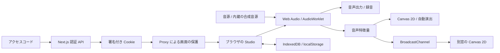

# DJ/VJ Studio

**音楽を繋ぐ。映像を動かす。ブラウザひとつを、イベントの演出ブースに。**

OpenAI DevDay 2026 に関連するハッカソン向けに制作した、2デッキ DJ・128パッドサンプラー・音楽に反応する VJ を統合した Web アプリです。内蔵デモ音源で、音楽ファイルを用意せずに試せます。

> A browser-based performance studio combining automatic DJ transitions, a 128-pad sampler, and audio-reactive visuals. Built with AI-assisted development; audio processing and rendering run locally in the browser.

| 項目 | 内容 |
| --- | --- |
| デモ | **https://djvj-app.vercel.app** |
| ログイン | 共有アクセスコード方式。審査用コードは応募時の提出情報で別途共有します |
| 対象 | イベント主催者、ハッカソン参加者、登壇者、小規模なライブ演出を担当する人 |
| 最初に試すもの | 内蔵デモ曲 → Auto DJ → DevDay テーマ → プロジェクター出力 |
| 音源の準備 | 初回起動時にブラウザ内でデモ3曲とサンプラー音源を合成 |
| 実装 | Next.js / React / TypeScript / Web Audio / AudioWorklet / Canvas 2D / IndexedDB |

## 解決したい課題

イベントで音楽と映像を演出するには、選曲、拍合わせ、音量調整、映像の切替、出力先の管理を同時に扱う必要があります。専用アプリや機材を揃え、DJ と VJ をそれぞれ操作する準備も発生します。

DJ/VJ Studio は、それらを同じブラウザにまとめます。自動選曲とミックスで音楽を継続し、その音声から抽出した特徴量で映像を動かします。自動演出を使いながら、演者がパッド・EQ・エフェクト・映像を手動で操作することもできます。

## デモの確認手順

1. [公開デモ](https://djvj-app.vercel.app)にアクセスし、共有されたアクセスコードでログインします。
2. **「▶ スタート」**を押します。音声の開始にはこのクリックが必要です。初回は「デフォルト音源の準備ができました」と表示されるまで待ちます。
3. **Library** でデモ曲を確認します。表示されない場合は **「⋯」→「内蔵キット / デモ曲を追加」**で生成できます。
4. 拍を合わせるミックスを試すには、`Tropical Sunrise`（102 BPM）と `Firestone Nights`（96 BPM）をチェックし、**「▶ 選んだ曲で Auto DJ 開始」**を押します。選曲後、もう一方のデッキに次の曲が準備されます。
5. 切替をすぐ確認する場合は **`M` キー**で Blend を実行します。通常の自動運転では設定された退出位置に近づくと繋ぎが始まります。波形・クロスフェーダー・EQ・次の曲への移行を確認できます。
6. ヘッダーの **Theme を DevDay 2026、演出を「キーノート」または「おまかせ」**にします。VJ パネルで `DD Launch`・`DD Swarm`・`DD Pulse` を切り替え、音楽に反応する描画を確認します。
7. VJ パネルの **「⤢ プロジェクター」**で別窓を開きます。別画面へ移し、`F` キーまたは画面クリックで全画面表示できます。メインタブは開いたままにします。

デモ音源は [合成コード](src/lib/audio/synth/songs.ts)から生成します。既存アーティストの楽曲ファイルや外部ストリーミングサービスへの接続は必要ありません。端末によって初回生成に時間がかかります。スマートフォンでは画面下部のタブで各パネルへ移動できます。

## この作品で確認できること

| 特徴 | 実際の動作 | 実装を確認する場所 |
| --- | --- | --- |
| 音楽の区切りを考慮した自動 DJ | BPM・キーを考慮した選曲、8小節フレーズ付近での退出、サビの入り位置調整、低音の交換 | [store.ts](src/lib/store.ts)、[AudioTicker.tsx](src/components/AudioTicker.tsx) |
| 拍ずれへの継続的な対応 | 拍の位相補正に加え、キックの波形から実際の時間差を推定 | [phase.ts](src/lib/audio/phase.ts)、[位相テスト](tests/phase.test.ts) |
| DJ と VJ の連動 | 音声のレベル・帯域・ビートを映像へ配信し、場面・色・動きを変化 | [features.ts](src/lib/audio/features.ts)、[featureBus.ts](src/lib/vj/featureBus.ts)、[director.ts](src/lib/vj/director.ts) |
| 音源なしで試せる体験 | デモ曲・ドラム・FX をブラウザ内で合成し、ライブラリとパッドへ配置 | [synth/](src/lib/audio/synth/)、[サンプラー UI](src/components/SamplerPads.tsx) |
| 演出の再利用 | テーマ・動き・色・レイヤーを Look として保存し、次の小節頭で呼び出し | [VJPanel.tsx](src/components/VJPanel.tsx)、[types.ts](src/lib/types.ts) |
| データを端末内で管理 | 音源・キュー・素材・設定の保存、ZIP バックアップ、セッションの再開 | [db.ts](src/lib/db.ts)、[zip.ts](src/lib/zip.ts)、[Library.tsx](src/components/Library.tsx) |
| 公開環境のアクセス制御 | サーバーでコードを検証し、署名付き Cookie でスタジオと投影画面を保護 | [auth.ts](src/lib/auth.ts)、[proxy.ts](src/proxy.ts)、[認証テスト](tests/auth.test.ts) |

## 自動で繋ぐ仕組み

1. **曲を解析する。** BPM・ビートグリッド・キー・無音区間・サビ候補・ボーカル存在度・ラウドネスを求めます。重い追加解析はアイドル時間に分散して実行します。
2. **次の曲を決める。** BPM やキーの相性を重みにした抽選で、再生履歴も考慮します。「次にこの曲」や指定の曲順があれば優先します。
3. **繋ぎ方と位置を決める。** テンポが近い場合は Blend を中心に選択し、差が大きい場合は Fade・Echo を使います。条件を満たす場合は8小節の Tempo Ramp も選択します。通常は退出位置を8小節のフレーズやサビの終わりへ寄せます。
4. **テンポ・拍・入り位置を合わせる。** 半分・倍の BPM 関係を考慮し、次の曲を現在の再生テンポに合わせます。次の曲のサビや見せ場がブレンド完了付近に来るよう、再生開始位置を調整します。
5. **音を交換する。** Blend では入る曲の低音を抑え、中間付近の小節で低音を入れ替えます。歌が重なると推定した場合は中域を抑えます。音量・クロスフェーダー・フィルターも変化させます。
6. **ずれを補正する。** テンポが一致したブレンドでは約0.5秒ごとに拍の位相を確認し、約6秒ごとにキックの包絡を比較して補正に反映します。

初期値の繋ぎ時間は32拍です。120 BPM なら約16秒に相当します。サビ連発モードは8拍を使います。EDM モードには Double Drop やブレイクからの切替もあります。具体的な動作は [autoMix](src/lib/store.ts) と [自動切替の判定](src/components/AudioTicker.tsx)で確認できます。

## 主な操作機能

| 領域 | 実装済みの機能 |
| --- | --- |
| DJ / Mixer | 2デッキ、全体・拡大波形、CUE、ホットキュー、ビートループ、ジョグ、スクラッチ、キーロック、キーシフト、3バンド EQ、フィルター、ヘッドホンキュー、録音 |
| Auto DJ | 選曲対象・曲順の指定、セットリスト、時間と曲数のプラン、サビ連発、エネルギーカーブ、ミックスの中止 |
| Sampler / Drums | 8バンク×16パッド、トリム、One-shot / Gate / Loop / Toggle、16ステップシーケンサー、909 / 808 風キット、マイク録音、読み上げパッド |
| VJ | Canvas 2D プリセット、自動シーン演出、2つのプリセットの合成、画像・動画レイヤー、ロゴ・キャプション、Look、別窓への投影 |
| 入出力 | MIDI Learn、マイク加工・トークオーバー、マスター録音、キーボード操作 |
| 運用 | アクセスコード認証、ブラウザ保存、一時保存、ZIP バックアップ、セッション復元、パネル単位のエラー境界 |

操作中は **`?`** でショートカット一覧を表示できます。`Backspace` はミックス中止、`Tab` は本番表示の切替です。ヘッドホン出力先の変更や MIDI 接続は、ブラウザ・OS・接続機器の対応状況に依存します。

## OpenAI DevDay 2026 との関係・AI の活用

[OpenAI DevDay 2026 の公式ページ](https://openai.com/ja-JP/devday/2026/)では、AI を使った開発や、アイデアを製品へ進める事例が紹介されています。本プロジェクトでは、イベントで実際に触れられる音楽・映像の体験を Web アプリとして実装しました。

- **開発での活用:** Codex による開発支援を利用し、アクセスコード認証の実装、テスト、Vercel へのデプロイ、ドキュメント整備を進めています。
- **イベントに合わせた表現:** DevDay を題材にした文字・ブラケット・ドットのアニメーションを実装しています。発表名やセッション名は VJ の表示コンテンツとして扱います。[DevDay 描画コード](src/lib/vj/devday.ts)
- **実行時の処理:** 音声解析・合成・ミックス・映像描画は、Web Audio と Canvas を使ってブラウザ内で実行します。現在のアプリから OpenAI API を呼び出す処理はありません。

## アーキテクチャ



| 場所 | 責務 |
| --- | --- |
| `src/app/` | メイン画面、ログイン、投影画面、ログイン・ログアウト API |
| `src/lib/store.ts` | DJ の操作・選曲・ミックス・保存・復元の状態管理 |
| `src/lib/audio/` | デッキ、音声ルーティング、解析、サンプラー、シーケンサー、音源合成 |
| `public/keylock-worklet.js` / `public/scratch-worklet.js` | キーロックと双方向スクラッチの音声処理 |
| `src/lib/vj/` | 描画プリセット、シーン演出、ワンショット FX、特徴量の配信 |
| `src/lib/db.ts` / `src/lib/zip.ts` | ブラウザ保存とバックアップ |
| `src/lib/auth.ts` / `src/proxy.ts` | アクセスコードの照合、セッション署名、画面のアクセス制御 |
| `tests/` | 認証・音楽補助ロジック・演出パラメータ・ZIP の単体テスト |

## ローカルで起動する

Node.js 26 と npm を使用します。テストは Node の TypeScript 直接実行に対応した構成です。

```bash
npm ci
```

次のコマンドで、ローカル用アクセスコードと署名鍵を生成します。コードはターミナルに表示されます。既存の `.env.local` は上書きしません。

```bash
node --input-type=module <<'NODE'
import { createHash, randomBytes } from 'node:crypto';
import { writeFileSync } from 'node:fs';
const code = randomBytes(12).toString('base64url');
const hash = createHash('sha256').update(code).digest('hex');
const secret = randomBytes(32).toString('hex');
writeFileSync('.env.local', `ACCESS_CODE_HASH=${hash}\nAUTH_SECRET=${secret}\n`, { flag: 'wx', mode: 0o600 });
console.log('ローカル用アクセスコード:', code);
NODE
npm run dev
```

http://localhost:3000 を開き、発行したコードでログインします。音源・マイク・描画の確認にはブラウザが必要です。

## 検証

```bash
npm test
npx next typegen
npx tsc --noEmit -p .
npm run lint
npm run build
```

`npm test` は14件の単体テストを実行します。

| テスト | 確認する内容 |
| --- | --- |
| [auth.test.ts](tests/auth.test.ts) | コードの照合、未設定時の拒否、署名改ざん・期限切れ・コード変更、外部への転送や異なる Origin の拒否 |
| [phase.test.ts](tests/phase.test.ts) | 合成キックの時間差検出。40 ms のずれを誤差8 ms以内で検出するケース、先行・再生速度差のケース |
| [key.test.ts](tests/key.test.ts) | Camelot 番号、キーの相性、互換キーへのシフト |
| [show.test.ts](tests/show.test.ts) | 演出パラメータの補間、ストロボ設定、保存 Look の参照整合性 |
| [zip.test.ts](tests/zip.test.ts) | 日本語ファイル名とバイナリデータを含む ZIP の書き出し・読み込み |

単体テストの対象は上記の範囲です。楽曲全般での解析精度、音の聴感、実機の音声出力・MIDI・描画は、デモ手順に沿って確認できます。公開時には本番 URL で未ログイン時の転送、コード照合、認証後の画面取得、ログアウトの HTTP 応答も確認しています。

## 保存・ログイン・デプロイ

- **保存先:** 音源・サンプル・キュー・プレイリスト・素材・設定は IndexedDB、再開状態や MIDI 割り当てなどは localStorage に保存します。音源をサーバーへアップロードする処理はありません。
- **端末間の移動:** 同じアクセスコードでもデータは同期されません。別端末や localhost から公開 URL へ移す場合は、Library の ZIP バックアップを使います。ログアウト後も端末内の保存データは残ります。
- **認証:** `ACCESS_CODE_HASH` にコードの SHA-256、`AUTH_SECRET` に署名鍵を設定します。ログインは署名付き HttpOnly / Secure / SameSite=Lax Cookie で7日間保持し、コードや署名鍵の変更で既存セッションも無効になります。
- **公開:** Vercel の Production / Preview に両変数を Sensitive として登録し、`npx vercel --prod` でデプロイします。環境変数とコード原文は Git に追加しません。
- **PWA:** ホーム画面への追加と静的ファイルのキャッシュに対応します。認証対象の HTML と認証 API はキャッシュせず、起動・再読み込み時はネット接続が必要です。

## 現在の制約と次の改善

- 拍合わせとフレーズ処理は主に4拍子・一定テンポの曲を想定しています。BPM・キー・サビ・ボーカル区間は推定値で、手動補正の操作を用意しています。
- 大きい音源のデコードや合成には端末のメモリ・CPU・ブラウザ容量を使います。保存データは ZIP でもバックアップできます。
- 共有コードによる入場方式です。個別ユーザーのアカウント、クラウド音源保存、端末間同期は今後の拡張対象です。
- 自動演出ではストロボを無効にしています。手動の演出には点滅が含まれるため、会場に合わせてストロボ設定と音量を調整してください。
- 次の改善として、実曲を使った解析精度の評価、主要ブラウザでの音声・描画の継続テスト、WebGL による描画の拡張を検討しています。
