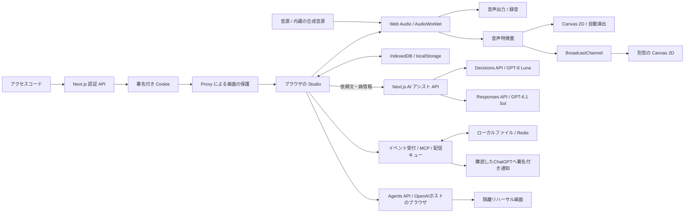

# DJ/VJ Studio

**音楽を繋ぐ。映像を動かす。ブラウザひとつを、イベントの演出ブースに。**

OpenAI DevDay 2026 に関連するハッカソン向けに制作した、2デッキ DJ・128パッドサンプラー・音楽に反応する VJ を統合した Web アプリです。内蔵デモ音源で、音楽ファイルを用意せずに試せます。

> A browser-based performance studio combining automatic DJ transitions, a 128-pad sampler, and audio-reactive visuals. Built with AI-assisted development; audio processing and rendering run locally in the browser.

| 項目 | 内容 |
| --- | --- |
| デモ | **https://djvj-app.vercel.app** |
| ログイン | 共有アクセスコード方式。審査用コードは応募時の提出情報で別途共有します |
| 対象 | イベント主催者、ハッカソン参加者、登壇者、小規模なライブ演出を担当する人 |
| 最初に試すもの | 内蔵デモ曲 → Auto DJ → DevDay テーマ → プロジェクター出力 |
| 音源の準備 | 初回起動時にブラウザ内でデモ3曲とサンプラー音源を合成 |
| 実装 | Next.js / React / TypeScript / Web Audio / AudioWorklet / Canvas 2D / IndexedDB |

## 解決したい課題

イベントで音楽と映像を演出するには、選曲、拍合わせ、音量調整、映像の切替、出力先の管理を同時に扱う必要があります。専用アプリや機材を揃え、DJ と VJ をそれぞれ操作する準備も発生します。

DJ/VJ Studio は、それらを同じブラウザにまとめます。自動選曲とミックスで音楽を継続し、その音声から抽出した特徴量で映像を動かします。自動演出を使いながら、演者がパッド・EQ・エフェクト・映像を手動で操作することもできます。

## デモの確認手順

1. [公開デモ](https://djvj-app.vercel.app)にアクセスし、共有されたアクセスコードでログインします。
2. **「▶ スタート」**を押します。音声の開始にはこのクリックが必要です。初回は「デフォルト音源の準備ができました」と表示されるまで待ちます。
3. **Library** でデモ曲を確認します。表示されない場合は **「⋯」→「内蔵キット / デモ曲を追加」**で生成できます。
4. 拍を合わせるミックスを試すには、`Tropical Sunrise`（102 BPM）と `Firestone Nights`（96 BPM）をチェックし、**「▶ 選んだ曲で Auto DJ 開始」**を押します。選曲後、もう一方のデッキに次の曲が準備されます。
5. 切替をすぐ確認する場合は **`M` キー**で Blend を実行します。通常の自動運転では設定された退出位置に近づくと繋ぎが始まります。波形・クロスフェーダー・EQ・次の曲への移行を確認できます。
6. ヘッダーの **Theme を DevDay 2026、演出を「キーノート」または「おまかせ」**にします。VJ パネルで `DD Launch`・`DD Swarm`・`DD Pulse` を切り替え、音楽に反応する描画を確認します。
7. VJ パネルの **「⤢ プロジェクター」**で別窓を開きます。別画面へ移し、`F` キーまたは画面クリックで全画面表示できます。メインタブは開いたままにします。

デモ音源は [合成コード](src/lib/audio/synth/songs.ts)から生成します。既存アーティストの楽曲ファイルや外部ストリーミングサービスへの接続は必要ありません。端末によって初回生成に時間がかかります。スマートフォンでは画面下部のタブで各パネルへ移動できます。

## この作品で確認できること

| 特徴 | 実際の動作 | 実装を確認する場所 |
| --- | --- | --- |
| 音楽の区切りを考慮した自動 DJ | BPM・キーを考慮した選曲、8小節フレーズ付近での退出、サビの入り位置調整、低音の交換 | [store.ts](src/lib/store.ts)、[AudioTicker.tsx](src/components/AudioTicker.tsx) |
| 拍ずれへの継続的な対応 | 拍の位相補正に加え、キックの波形から実際の時間差を推定 | [phase.ts](src/lib/audio/phase.ts)、[位相テスト](tests/phase.test.ts) |
| DJ と VJ の連動 | 音声のレベル・帯域・ビートを映像へ配信し、場面・色・動きを変化 | [features.ts](src/lib/audio/features.ts)、[featureBus.ts](src/lib/vj/featureBus.ts)、[director.ts](src/lib/vj/director.ts) |
| 音源なしで試せる体験 | デモ曲・ドラム・FX をブラウザ内で合成し、ライブラリとパッドへ配置 | [synth/](src/lib/audio/synth/)、[サンプラー UI](src/components/SamplerPads.tsx) |
| 演出の再利用 | テーマ・動き・色・レイヤーを Look として保存し、次の小節頭で呼び出し | [VJPanel.tsx](src/components/VJPanel.tsx)、[types.ts](src/lib/types.ts) |
| データを端末内で管理 | 音源・キュー・素材・設定の保存、ZIP バックアップ、セッションの再開 | [db.ts](src/lib/db.ts)、[zip.ts](src/lib/zip.ts)、[Library.tsx](src/components/Library.tsx) |
| 公開環境のアクセス制御 | サーバーでコードを検証し、署名付き Cookie でスタジオと投影画面を保護 | [auth.ts](src/lib/auth.ts)、[proxy.ts](src/proxy.ts)、[認証テスト](tests/auth.test.ts) |

## 自動で繋ぐ仕組み

1. **曲を解析する。** BPM・ビートグリッド・キー・無音区間・サビ候補・ボーカル存在度・ラウドネスを求めます。重い追加解析はアイドル時間に分散して実行します。
2. **次の曲を決める。** BPM やキーの相性を重みにした抽選で、再生履歴も考慮します。「次にこの曲」や指定の曲順があれば優先します。
3. **繋ぎ方と位置を決める。** テンポが近い場合は Blend を中心に選択し、差が大きい場合は Fade・Echo を使います。条件を満たす場合は8小節の Tempo Ramp も選択します。通常は退出位置を8小節のフレーズやサビの終わりへ寄せます。
4. **テンポ・拍・入り位置を合わせる。** 半分・倍の BPM 関係を考慮し、次の曲を現在の再生テンポに合わせます。次の曲のサビや見せ場がブレンド完了付近に来るよう、再生開始位置を調整します。
5. **音を交換する。** Blend では入る曲の低音を抑え、中間付近の小節で低音を入れ替えます。歌が重なると推定した場合は中域を抑えます。音量・クロスフェーダー・フィルターも変化させます。
6. **ずれを補正する。** テンポが一致したブレンドでは約0.5秒ごとに拍の位相を確認し、約6秒ごとにキックの包絡を比較して補正に反映します。

初期値の繋ぎ時間は32拍です。120 BPM なら約16秒に相当します。サビ連発モードは8拍を使います。EDM モードには Double Drop やブレイクからの切替もあります。具体的な動作は [autoMix](src/lib/store.ts) と [自動切替の判定](src/components/AudioTicker.tsx)で確認できます。

## 主な操作機能

| 領域 | 実装済みの機能 |
| --- | --- |
| DJ / Mixer | 2デッキ、全体・拡大波形、CUE、ホットキュー、ビートループ、ジョグ、スクラッチ、キーロック、キーシフト、3バンド EQ、フィルター、ヘッドホンキュー、録音 |
| Auto DJ | 選曲対象・曲順の指定、セットリスト、時間と曲数のプラン、サビ連発、エネルギーカーブ、ミックスの中止 |
| Sampler / Drums | 8バンク×16パッド、トリム、One-shot / Gate / Loop / Toggle、16ステップシーケンサー、909 / 808 風キット、マイク録音、読み上げパッド |
| VJ | Canvas 2D プリセット、自動シーン演出、2つのプリセットの合成、画像・動画レイヤー、ロゴ・キャプション、Look、別窓への投影 |
| 入出力 | MIDI Learn、マイク加工・トークオーバー、マスター録音、キーボード操作 |
| 運用 | アクセスコード認証、ブラウザ保存、一時保存、ZIP バックアップ、セッション復元、パネル単位のエラー境界 |
| イベント連携 | MCP 2.0のイベント購読・解除、進行変更・希望曲の記録、署名付きWebhook、永続的な再送キュー |
| リハーサル | 本番データから分離したVJ描画・入力検証、デスクトップ・モバイルの自動実行、Agentsによる画面操作・結果取得 |

操作中は **`?`** でショートカット一覧を表示できます。`Backspace` はミックス中止、`Tab` は本番表示の切替です。ヘッドホン出力先の変更や MIDI 接続は、ブラウザ・OS・接続機器の対応状況に依存します。

## OpenAI DevDay 2026 との関係・AI の活用

[DevDay 2026 の公式発表](https://openai.com/ja-JP/index/devday-2026-recap/)と[発表まとめ記事](https://zenn.dev/schroneko/articles/openai-devday-2026)を参照し、DJ/VJ の操作やイベント準備に活用できる機能を検討しています。API の仕様・提供条件は公式ドキュメントで確認します。

### コードに実装済みの連携

Decisions API による Look 提案と GPT-6.1 Sol によるセットリスト提案はコードに実装済みです。利用には APIキーの設定が必要で、実際のモデルへの接続・提案品質は設定後に確認します。

- **開発での活用:** Codex による開発支援を利用し、アクセスコード認証の実装、テスト、Vercel へのデプロイ、ドキュメント整備を進めています。
- **イベントに合わせた表現:** DevDay を題材にした文字・ブラケット・ドットのアニメーションを実装しています。発表名やセッション名は VJ の表示コンテンツとして扱います。[DevDay 描画コード](src/lib/vj/devday.ts)
- **Decisions API:** 「AI アシスト」の「映像の場面」で、依頼文から既存の Look を提案します。GPT-6 Luna の有限選択を使い、意図が曖昧な場合や確信度が低い場合は切替を提案しません。確認後に反映すると、再生中は次の小節頭で切り替わります。[公式仕様](https://developers.openai.com/api/docs/guides/decisions)
- **GPT-6.1 Sol:** 「セットリスト」で、対象曲の名前・BPM・キー・長さから理由付きの曲順を提案します。Structured Outputs とサーバー検証により対象外・重複・曲数不一致を拒否します。対象は2〜80曲、提案は2〜20曲です。反映ボタンで既存キューを置き換えます。Auto DJ・ミックス・セットプランが動作中は反映できません。再生開始は別操作です。[モデルの公式仕様](https://developers.openai.com/api/docs/models/gpt-6.1-sol)
- **実行時の処理:** 音声解析・合成・ミックス・映像描画は、引き続きブラウザ内で実行します。AI アシストは「提案する」を押した場合に、依頼文と必要な曲情報・識別子を送信します。音源・波形・キュー情報は送信しません。曲順は音を聴かずに作成するため、聴感での確認が必要です。イベント通知とAgents実行の送信内容は以下に記載します。

AI アシストを使う場合は、サーバーの `.env.local` または Vercel の環境変数に `OPENAI_API_KEY` を設定して再起動・再デプロイします。キーに `NEXT_PUBLIC_` を付けず、ブラウザや Git に公開しないでください。未設定でも従来の DJ/VJ 機能は利用できます。設定値の例は `OPENAI_API_KEY=<APIキー>` です。API 料金と各モデルの利用権限が必要です。Responses API は `store: false` で呼び出します（これは組織の Zero Data Retention 設定とは別です）。

新しい `/api/assistant` は既存セッション認証、同一 Origin 検証、入力サイズ制限、50秒のタイムアウト、同時リクエスト制限、1セッション・1分あたり6回の制限を備えます。回数制限はサーバーインスタンス単位の簡易制限です。複数インスタンス共通の利用枠は OpenAI 側でも設定してください。APIキー未設定・権限不足・利用枠超過は画面上で案内します。

### MCP Events（実装済み・外部接続は設定が必要）

画面上部の **「イベント連携・自動リハーサル」** で、Studio ID・件名・内容を入力し、**「イベントを記録・通知」**を押します。購読先がなくても記録でき、保存済みの同じ内容を再送してもイベントを重複登録しません。外部の受付・進行管理システムからは、同じ `/api/automation` へBearer認証でPOSTできます。公開の受付フォームは含みません。

| イベント | 内容 |
| --- | --- |
| `schedule.updated` | 進行表・運営メモの変更 |
| `request.created` | 希望曲・演出リクエストの到着 |
| `rehearsal.completed` | リハーサル結果。Agentsの終了を取得した際には、終了ステータスと報告を自動で一度だけ記録する |

`POST /api/mcp` はMCP 2.0（`2026-07-28`）の `server/discover`、`events/list`、`events/subscribe`、`events/unsubscribe` に対応するイベント専用エンドポイントです。現在はツール呼び出しを公開していません。購読は `studioId` とイベント名で絞り、通知先のチャレンジ検証が成功してから保存します。ユーザーがChatGPT側で「何を監視し、到着時に何をするか」を設定すると、その指示に沿って通知が処理されます。[公式の接続仕様](https://developers.openai.com/plugins/build/mcp-events)

購読・通知待ち・実行履歴の保存には、次の2方式を用意しています。

- **ローカル / 単一プロセスの自己ホスト:** `.data/automation/state.json` に保存します。ディレクトリは0700、ファイルは0600で作成し、書き込みは一時ファイルから置換します。`AUTOMATION_DATA_DIR` で保存先を変更できます。`.data/` はGitとVercelへのアップロードから除外しています。
- **Vercel / 複数インスタンス:** `UPSTASH_REDIS_REST_URL` と `UPSTASH_REDIS_REST_TOKEN` を設定します。Redisの比較更新で競合を検出し、配信ジョブのリースで同時実行による二重送信を抑えます。Vercelで未設定の場合、イベント保存・Agents実行は利用できません。ローカルファイル方式は複数プロセス間の排他には対応しません。

サーバーの環境変数を設定し、再起動または再デプロイします。値を `NEXT_PUBLIC_` で公開しないでください。

| 変数 | 用途 |
| --- | --- |
| `AUTOMATION_TOKEN` | 32文字以上の共有Bearerトークン。MCP接続と外部システムのイベント登録に使う |
| `MCP_CALLBACK_HOSTS` | 接続時にChatGPTから提示される通知先のホスト名を、カンマ区切りで正確に登録する。ワイルドカードは使わない |
| `UPSTASH_REDIS_REST_URL` / `UPSTASH_REDIS_REST_TOKEN` | Vercel・複数インスタンスでの永続保存先 |
| `CRON_SECRET` | 定期配信を設定する場合の32文字以上の認証鍵 |

このMCP接続は、同じStudioを共有する運営者向けのBearer認証です。ユーザーごとのOAuth・複数テナント管理は含みません。トークンを知る接続先は全Studio IDを購読・登録できます。トークンを変更すると以前の購読は配信対象から外れます。

ChatGPTの対応するプラグイン接続で、MCP URLを `https://<公開先>/api/mcp` とし、Authorizationヘッダーに `Bearer <AUTOMATION_TOKEN>` を設定します。カスタムBearerヘッダーに対応する接続経路が必要です。接続後にイベント一覧を再取得し、たとえば `schedule.updated` / `studioId: main` を監視するよう依頼します。サーバーの疎通確認例です（両変数をシェルに設定してから実行）。

```bash
curl "$DJVJ_URL/api/mcp" \
  -H "Authorization: Bearer $AUTOMATION_TOKEN" \
  -H 'Content-Type: application/json' \
  --data '{"jsonrpc":"2.0","id":1,"method":"server/discover"}'
```

WebhookはStandard Webhooks形式のHMAC署名を付け、HTTPS・登録済みホスト・接続時の公開IP検証を必須にしています。DNSで検証したIPへ接続し、元のホスト名でTLSを検証します。プライベートIP・メタデータIP・リダイレクトを拒否します。署名鍵の更新時は5分間、旧鍵と新鍵の両方で署名します。購読の有効期間は最大24時間で、更新・期限切れ・解除を扱います。

通知は保存した後に送信します。失敗時は同じイベントIDを使い、5秒からの指数バックオフで最大6回試行します。410・413や永続的な4xxは再送せず、410では購読も停止します。成功直後のプロセス停止などでは再配信される可能性があるため、受信側もイベントIDで重複排除します。履歴は直近200件、配信待ちは最大200件で、履歴の再生は提供しません（`cursor: null`）。

配信待ちは画面の **「配信待ちを再送」** か、`POST /api/automation/dispatch` で処理できます。無人で再送を続ける場合は、外部スケジューラーから **`GET /api/automation/dispatch` を1分ごと**に呼び、`Authorization: Bearer <CRON_SECRET>` を付けます。定期ジョブ自体の登録は環境に合わせて行います。ブラウザ内のポーリングで代用しない構成です。

### 自動リハーサル（実装済み）

**API不要の実行:** 「イベント連携・自動リハーサル」から **「隔離リハーサルを開く（API不要）」→「自動リハーサル開始」** を押します。`/rehearsal` は実際のVJプリセット描画コードとAI入力検証コードを使い、全24プリセットの描画、音源を送信項目に含めないこと、対象外の曲・低確信度の提案の拒否、自動演出のストロボOFFを確認します。結果JSONを保存でき、DevDay / ディープの切替も試せます。音源・IndexedDB・本番の再生キューは読み書きしません。

コマンドでも再現できます。

```bash
npx playwright install chromium
npm run rehearsal
```

コマンドは本番ビルドを作り、一時的な認証鍵と保存先でポート3031に検証サーバーを起動します。別のブラウザコンテキストで1440px・390pxの28項目ずつを実行し、場面切替、JSON保存、横はみ出し、ブラウザ例外を確認します。イベント記録・重複防止は実際のローカルAPIで、Agentsの開始・承認・結果取得・JSON保存・削除はモックAPIで確認します。結果とスクリーンショットは `.playwright-mcp/rehearsal/` に保存します。既存サーバーを検証する場合は `REHEARSAL_URL` を指定できます（その環境と同じ認証設定が必要で、イベント登録テストは行いません）。

**Agentsによる画面操作:** 以下の設定を追加し、パネルの **「Agentsで開始」**を押します。[公式のComputer use仕様](https://developers.openai.com/api/docs/guides/agents-api/tools/computer-use)に基づき、`OpenAI-Beta: agents=v1` 付きでセッションを作成します。

| 変数 | 用途 |
| --- | --- |
| `OPENAI_API_KEY` | Agentsセッションの読み書きと推論に使う。`api.agents.read`・`api.agents.write`・`api.responses.write` の権限が必要 |
| `REHEARSAL_BASE_URL` | リハーサル画面を配信する公開HTTPSオリジン。例: `https://your-preview.vercel.app`。localhostにはOpenAIのブラウザから接続できない |
| `REHEARSAL_MODEL` | 任意。既定は `gpt-6.1-sol` |
| `REHEARSAL_STUDIO_ID` | 任意。結果イベントのStudio ID。既定は `main` |

Agentsは15分で失効する、`/rehearsal` だけを開ける署名付きチケットで接続します。このチケットから本番StudioやAPIへログインすることはできません。接続先への承認要求はパネルに表示し、設定した検証オリジンのみ許可できます。別オリジンやログイン要求は拒否できます。画面の操作履歴、ターンの状態、エージェントの報告を取得・保存できます。

セッションは実行IDを保存してから作成し、同じIDによる二重作成を防ぎます。作成結果がタイムアウトなどで不明になった場合は自動再作成せず、OpenAI側のメタデータ `djvj_run_id` を確認し、パネルで対応するセッションIDを照合して復旧します。終了後は **「停止・セッション削除」**でクラウド環境の削除を要求します。画面を閉じてもAgentsは停止しないため、終了・削除まで確認してください。

Agentsの終了を取得すると、その終了状態と報告を `rehearsal.completed` として一度だけ記録し、購読先へ配信します。`completed` はエージェントのターン終了を表し、検証項目がすべて成功した保証ではありません。報告中の成功・失敗件数も確認してください。自動結果記録にはパネルでの結果取得が必要です。

検証対象は隔離画面の描画・入力検証・画面操作です。音声の聴感、拍合わせ、MIDI、実機出力、本番Studio全体の操作は別途確認します。Agentsのスクリーンショットはセッション作成時に有効化していますが、取得した履歴で画像が省略される場合があります。確実な画面保存にはローカルのPlaywrightリハーサルを使います。実際のChatGPT購読・通知受信、Redis本番接続、Agentsの実API接続は、各環境を設定したうえで確認する必要があります。

### 追加実装の候補（未実装）

以下は発表された技術と既存コードを組み合わせた、このアプリ独自の実装案です。優先度は操作上の効果と既存機能の再利用のしやすさで判断しています。提供条件の確認日は2026年10月18日です。

| 優先度 | 候補・利用する発表 | このアプリでできるようにすること | 既存機能の活用と追加作業 |
| --- | --- | --- | --- |
| 高 | **自然文での操作予約** / [Decisions API](https://developers.openai.com/api/docs/guides/decisions) | 「次はこの曲」「サビ中心に」「落ち着いたモードへ」を、対応する操作と対象曲の候補へ変換する | `setNextOverride`・`applyMode`・`setChorusMode` を活用。操作・曲IDの候補を限定し、実行内容のプレビューと反映を追加する |
| 高 | **曲と映像をまとめた進行表** / [GPT-6.1 Sol](https://developers.openai.com/api/docs/models/gpt-6.1-sol) | 「30分、登壇前は静かに、最後に盛り上げる」から曲順・各区間の長さ・Look・キャプションをまとめて提案する | セットプラン・Look・`overlayText` を活用。構造化した進行表の検証、編集画面、保存、区間ごとの実行スケジューラーを追加する |
| 中 | **曲の状況を踏まえた演出提案** / [Decisions API](https://developers.openai.com/api/docs/guides/decisions) | 依頼文に加え、現在のBPM・帯域レベル・既存の解析結果から次の場面を提案する | `AudioFeatures`・`TrackMeta`・既存の自動演出を活用。送信する特徴量の要約と呼び出し間隔を追加し、拍ごとの描画は端末内で続ける |
| 低 | **提案の速度を優先する設定** / [Ultrafast](https://developers.openai.com/api/docs/models/gpt-6.1-sol) | セットリストや進行表の生成で、料金を確認したうえで高速な生成を選べるようにする | Sol の Responses API 呼び出しに `service_tier: "ultrafast"` を指定する選択肢を追加。標準より高い料金と生成時間を比較して選べるようにする |
| 中 | **ChatGPT内の選曲・演出パネル** / [Plugin Extensions](https://developers.openai.com/plugins/build/extensions) | 会話の横でセットリストやLookの候補を編集し、Studioへ渡す。保存した進行表の専用ビューアーも提供する | MCPサーバー、プラグイン、パネルUI、Studioとの受け渡しを追加。最初は進行表のファイル入出力で接続できる |
| 条件付き | **ChatGPTアカウントでのログイン** / [Sign in with ChatGPT](https://developers.openai.com/siwc/quickstart) | 共有コード方式に加え、個人を識別した設定・進行表の管理へ拡張する。利用条件が合えば、ユーザーのChatGPTプランでの推論も検討する | クライアント登録、OIDC / PKCE、トークン検証、アプリ側のユーザー・セッション管理を追加。ログインとプラン利用の認可は別々に扱う |
| 中 | **運営チーム向け資料の書き出し** / [ChatGPT Space・Pages](https://learn.chatgpt.com/docs/whats-new/devday-2026) | 曲順・演出予定・再生履歴をMarkdown / CSVで書き出し、チームが進行資料として持ち込めるようにする | プレイリスト・`playLog`・Lookを活用して出力形式を追加。SpaceやPagesへの自動保存は、利用可能なAPI・コネクターの確認後に検討する |
| 条件付き | **運営用の共有ダッシュボード** / [Sites とプラグインの連携](https://learn.chatgpt.com/docs/whats-new/devday-2026) | 運営者ごとに接続したアプリの進行資料や希望曲を確認し、Studioへ渡す案をまとめる | 対応ワークスペース内のSitesとプラグインを別途用意。現在のVercel上のStudioとは、認証付きAPIや進行表のファイルで接続する |

次に着手するなら、**自然文での操作予約 → 曲と映像の進行表 → ChatGPT内の編集パネル**の順を推奨します。前の段階で作る操作・進行表のデータ形式を、そのまま次の連携に使えるためです。

導入条件は次のとおりです。

- **端末内データとの接続:** 現在の音源・曲情報はブラウザのIndexedDBにあります。ChatGPTのパネルやOpenAIホストのブラウザから元のStudioの保存データへ直接アクセスできる前提にはせず、ユーザーが渡す曲情報・進行表か、認証した接続経路を用意します。音声の開始にはStudio側でのユーザー操作が必要です。
- **ChatGPTログインの提供範囲:** 商用サインインは選定パートナー向けの限定トライアルです。ChatGPTプラン利用はオープンソース向けの経路もあり、本プロジェクトの公開形態・ライセンス・利用するモデルとエンドポイントが条件に合うか確認する必要があります。通常のAPIキーによるDecisions / Responsesの呼び出しが、ログインだけでサブスクリプション枠に切り替わることはありません。[公式の提供条件](https://developers.openai.com/siwc/quickstart)
- **プラグイン・自動処理の基盤:** MCP EventsにはMCP 2.0、購読の永続保存とWebhook配信が必要です。ChatGPTの対応画面・ワークスペース設定も確認します。Sites連携は対応するワークスペース内の非公開Sitesが対象です。[MCP Events](https://developers.openai.com/plugins/build/mcp-events)、[Sitesの提供範囲](https://learn.chatgpt.com/docs/whats-new/devday-2026)

### 開発・運営への導入候補（未設定）

| 発表 | このプロジェクトでの活用案 | 必要な準備 |
| --- | --- | --- |
| Codex Cloud・コードレビュー | 型チェック・Lint・単体テストを再現できる開発環境を用意し、変更のレビューとブラウザでの回帰確認を支援する | リポジトリ接続、クラウド環境、検証用アクセス設定。[DevDayの公式案内](https://learn.chatgpt.com/docs/whats-new/devday-2026) |
| Codex Security Cloud | 認証API、AI用API、依存関係を継続的に調査し、修正案をレビューする | GitHubへの接続権限、Security Cloudの設定、利用料金の確認。[セットアップ](https://learn.chatgpt.com/docs/security/setup)、[課金条件](https://learn.chatgpt.com/docs/security/faq) |
| dots・共有タスク | イベントごとの準備状況を継続して確認し、資料の更新やセット案の下書きを運営チームへ戻す | 対応するChatGPT環境とプラグイン接続。Studioの情報を読み書きするツールを用意する。[DevDayの公式案内](https://learn.chatgpt.com/docs/whats-new/devday-2026) |

## アーキテクチャ



| 場所 | 責務 |
| --- | --- |
| `src/app/` | メイン画面、ログイン、投影画面、認証・AI アシスト API |
| `src/lib/ai/` | AI への送信項目、リクエスト生成、提案の検証 |
| `src/lib/automation/` | イベント・購読・配信キュー、Webhook検証・署名、永続保存、Agentsセッション管理 |
| `src/app/rehearsal/` / `scripts/rehearsal.mjs` | 隔離リハーサル画面とブラウザでの自動検証 |
| `src/lib/store.ts` | DJ の操作・選曲・ミックス・保存・復元の状態管理 |
| `src/lib/audio/` | デッキ、音声ルーティング、解析、サンプラー、シーケンサー、音源合成 |
| `public/keylock-worklet.js` / `public/scratch-worklet.js` | キーロックと双方向スクラッチの音声処理 |
| `src/lib/vj/` | 描画プリセット、シーン演出、ワンショット FX、特徴量の配信 |
| `src/lib/db.ts` / `src/lib/zip.ts` | ブラウザ保存とバックアップ |
| `src/lib/auth.ts` / `src/proxy.ts` | アクセスコードの照合、セッション署名、画面のアクセス制御 |
| `tests/` | 認証・音楽補助ロジック・演出パラメータ・ZIP の単体テスト |

## ローカルで起動する

Node.js 26 と npm を使用します。テストは Node の TypeScript 直接実行に対応した構成です。

```bash
npm ci
```

次のコマンドで、ローカル用アクセスコードと署名鍵を生成します。コードはターミナルに表示されます。既存の `.env.local` は上書きしません。

```bash
node --input-type=module <<'NODE'
import { createHash, randomBytes } from 'node:crypto';
import { writeFileSync } from 'node:fs';
const code = randomBytes(12).toString('base64url');
const hash = createHash('sha256').update(code).digest('hex');
const secret = randomBytes(32).toString('hex');
writeFileSync('.env.local', `ACCESS_CODE_HASH=${hash}\nAUTH_SECRET=${secret}\n`, { flag: 'wx', mode: 0o600 });
console.log('ローカル用アクセスコード:', code);
NODE
npm run dev
```

http://localhost:3000 を開き、発行したコードでログインします。音源・マイク・描画の確認にはブラウザが必要です。

## 検証

```bash
npm test
npx next typegen
npx tsc --noEmit -p .
npm run lint
npm run build
npm run rehearsal
```

`npm test` は純粋なロジックとデータ契約の単体テストを実行します。

| テスト | 確認する内容 |
| --- | --- |
| [auth.test.ts](tests/auth.test.ts) | コードの照合、未設定時の拒否、署名改ざん・期限切れ・コード変更、外部への転送や異なる Origin の拒否 |
| [assistant.test.ts](tests/assistant.test.ts) | 送信項目の限定、対象曲・文字数の制限、Decisions の低確信度・拒否、Responses の未完了・不正な曲順の拒否 |
| [automation.test.ts](tests/automation.test.ts) | イベント項目・購読フィルター・重複排除・再送、Webhook署名・鍵更新・通知先制限、検証用チケットの改ざん・期限・用途制限 |
| [phase.test.ts](tests/phase.test.ts) | 合成キックの時間差検出。40 ms のずれを誤差8 ms以内で検出するケース、先行・再生速度差のケース |
| [key.test.ts](tests/key.test.ts) | Camelot 番号、キーの相性、互換キーへのシフト |
| [show.test.ts](tests/show.test.ts) | 演出パラメータの補間、ストロボ設定、保存 Look の参照整合性 |
| [zip.test.ts](tests/zip.test.ts) | 日本語ファイル名とバイナリデータを含む ZIP の書き出し・読み込み |

単体テストの対象は上記の範囲です。AI アシストの画面操作とAPI成功時・異常時はモック応答でも確認しています。実際のモデルへの接続と提案品質の確認には、APIキーを設定した環境が必要です。楽曲全般での解析精度、音の聴感、実機の音声出力・MIDI・描画は、デモ手順に沿って確認できます。公開時には本番 URL で未ログイン時の転送、コード照合、認証後の画面取得、ログアウトの HTTP 応答も確認しています。

## 保存・ログイン・デプロイ

- **保存先:** 音源・サンプル・キュー・プレイリスト・素材・設定は IndexedDB、再開状態や MIDI 割り当てなどは localStorage に保存します。音源をサーバーへアップロードする処理はありません。
- **自動処理の保存先:** 登録したイベント本文・購読先・署名鍵・配信状態・Agents実行IDはサーバーのファイルまたはRedisに保存します。通知時はイベント本文を購読先へ、Agents実行時は検証の指示と期限付きチケットをOpenAIへ送信します。
- **端末間の移動:** 同じアクセスコードでもデータは同期されません。別端末や localhost から公開 URL へ移す場合は、Library の ZIP バックアップを使います。ログアウト後も端末内の保存データは残ります。
- **認証:** `ACCESS_CODE_HASH` にコードの SHA-256、`AUTH_SECRET` に署名鍵を設定します。ログインは署名付き HttpOnly / Secure / SameSite=Lax Cookie で7日間保持し、コードや署名鍵の変更で既存セッションも無効になります。
- **公開:** Vercel の Production / Preview に両変数を Sensitive として登録し、`npx vercel --prod` でデプロイします。環境変数とコード原文は Git に追加しません。
- **PWA:** ホーム画面への追加と静的ファイルのキャッシュに対応します。認証対象の HTML と認証 API はキャッシュせず、起動・再読み込み時はネット接続が必要です。

## 現在の制約と次の改善

- 拍合わせとフレーズ処理は主に4拍子・一定テンポの曲を想定しています。BPM・キー・サビ・ボーカル区間は推定値で、手動補正の操作を用意しています。
- 大きい音源のデコードや合成には端末のメモリ・CPU・ブラウザ容量を使います。保存データは ZIP でもバックアップできます。
- 共有コードによる入場方式です。個別ユーザーのアカウント、クラウド音源保存、端末間同期は今後の拡張対象です。
- 自動演出ではストロボを無効にしています。手動の演出には点滅が含まれるため、会場に合わせてストロボ設定と音量を調整してください。
- 次の改善として、実曲を使った解析精度の評価、主要ブラウザでの音声・描画の継続テスト、WebGL による描画の拡張を検討しています。

## AIセットプラン・自動演出・Agentsリハーサル

サーバーの環境変数 **`OPENAI_API_KEY`** にOpenAI APIキーを登録してください。`NEXT_PUBLIC_`は付けません。VercelではProduction / PreviewにSensitiveで登録して再デプロイします。

- **AIセットプラン:** AIアシストのセットリストで「15分、最後に盛り上げて」などと入力。曲順・時間・エネルギーカーブ・Lookをまとめて提案し、反映後にセットプランを開始できます。
- **AI演出ディレクター:** 演出方針を入力し開始。30秒ごとにBPM・帯域レベルをDecisions APIへ送り、小節頭でLookを切り替えます。音源は送りません。停止・通信エラー時は自動要求を止めます。
- **Agents自動リハーサル:** APIキーと公開HTTPS URLで利用できます。Redis不要の署名付きセッション参照を使います。開始後、必要な接続許可を確認し「進捗・結果を取得」で操作結果を確認。「停止・セッション削除」でOpenAIのセッションを解放します。`REHEARSAL_BASE_URL`は任意で公開オリジンを指定できます。API料金・対象モデルの利用権限が必要です。

実APIの動作・提案品質はキー設定後に確認してください。キー未設定時は画面に設定方法を表示し、従来のDJ/VJ機能は使用できます。
